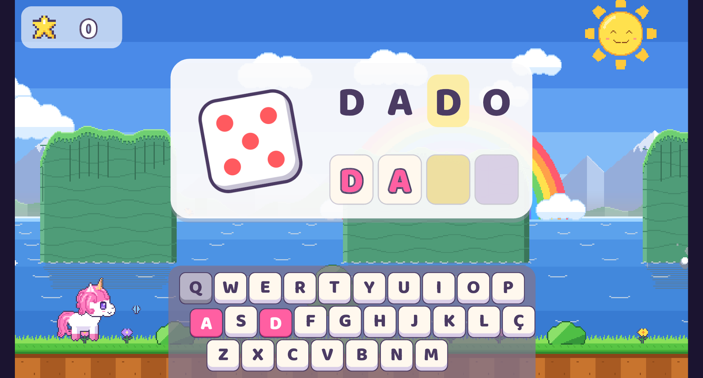
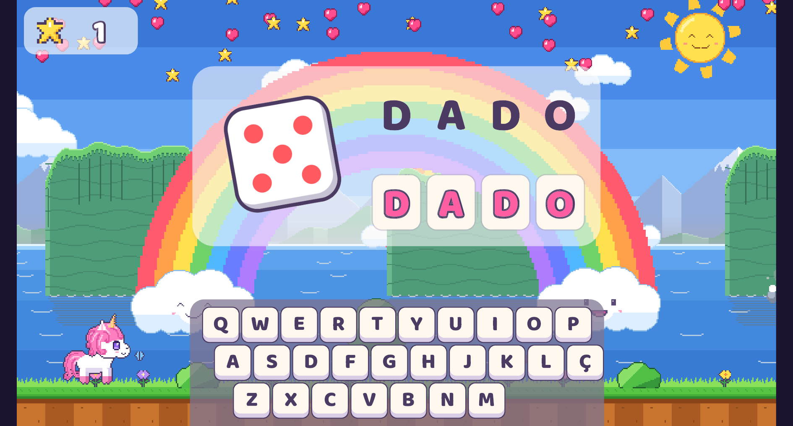

# Unicórnio

Jogo para crianças pequenas, com dois modos: passear e coletar corações e digitar palavras no teclado.

Não há como perder, o objetivo é iniciar a criança no uso do PC.


## Modos de jogo

### Passear

Um jogo de plataforma onde a criança ajuda o unicórnio a juntar corações. A cada 50 corações tem festa e a contagem recomeça do zero.


### Letras

Para treinar o teclado do computador enquanto aprende as letras e algumas palavras.

Aparecem um desenho e a palavra dele. A criança digita a mesma palavra, letra por letra: a
letra da vez fica marcada e a tecla dela acende no teclado da tela.



Com a palavra completa, ganha uma estrela e a festa do arco-íris; depois vem outra palavra.



## Disclaimer

- Este código foi todo gerado por IA.
- Fique à vontade para fazer fork, alterar e distribuir.
- Não é permitida distribuição comercial (veja os detalhes da [licença](LICENSE.md)).
- Se for distribuir, mencione este repo como sendo o original.
- Este jogo foi construído e testado no Linux Omarchy 4.5.0-3.
- Este jogo não foi testado em Windows.

## Controles

| Tecla | Ação |
|---|---|
| Seta esquerda / direita | Na tela inicial, escolhe o modo; no passeio, anda |
| Enter ou espaço | Na tela inicial, começa o modo escolhido |
| Espaço | No passeio, pula (segurar continua pulando) |
| Enter | No passeio, pausa / continua |
| Letras A–Z e Ç | No modo Letras, digitam a palavra |
| Esc (segurar ~1,5 s) | Volta à tela inicial; na tela inicial, sai do jogo |
| F11 | Tela cheia / janela |

## Rodando

Pré-requisito: [Rust](https://rustup.rs) 1.99 ou mais novo. No Linux, também as bibliotecas de
janela e som:

```sh
sudo pacman -S --needed alsa-lib libx11 libxi mesa                          # Arch
sudo apt-get install libasound2-dev libx11-dev libxi-dev libgl1-mesa-dev   # Debian/Ubuntu
```

```sh
cargo run --release
```

## Gerando o executável

- **Linux**: `cargo build --release` → `target/release/unicorn` (um arquivo só, ~1,4 MB).
- **Windows**: no próprio Windows, `cargo build --release` → `target\release\unicorn.exe`
  (não precisa de nenhuma biblioteca extra).
- **Windows a partir do Linux**: `rustup target add x86_64-pc-windows-gnu`, instalar o
  MinGW-w64 e rodar `cargo build --release --target x86_64-pc-windows-gnu`.

Detalhes técnicos (arquitetura, qualidade, decisões) em [DESENVOLVIMENTO.md](DESENVOLVIMENTO.md).

## Fonte

As letras do modo Letras usam a fonte [Baloo 2](https://github.com/EkType/Baloo2), da Ek Type,
sob a [SIL Open Font License 1.1](assets/fontes/OFL.txt). Ela vai embutida no executável, só
com as letras e os dígitos (`scripts/gerar-fonte.sh`).

## Licença

[PolyForm Noncommercial 1.0.0](LICENSE.md): pode usar, alterar e distribuir para fins não
comerciais, mantendo o aviso de autoria (`Required Notice`) do arquivo de licença.
