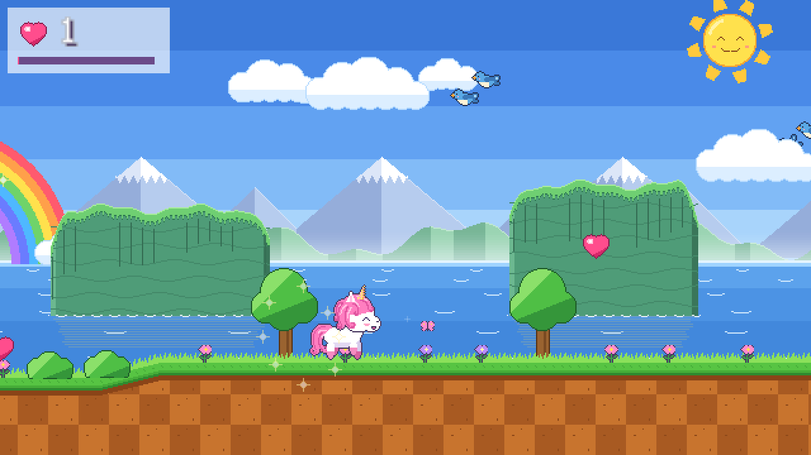

# Unicórnio

Jogo de plataforma para crianças pequenas. Não há como perder:
é só ajudar o unicórnio a juntar corações — a cada 50, tem festa e a contagem recomeça do zero.

## Disclaimer

- Este código foi todo gerado por IA.
- Fique à vontade para fazer fork, alterar e distribuir.
- Não é permitida distribuição comercial (veja os detalhes da [licença](LICENSE.md)).
- Se for distribuir, por favor mencione este repo como sendo o original.
- Este jogo foi construído e testado no Linux Omarchy 4.5.0-3.
- Este jogo não foi testado em Windows.



## Controles

| Tecla | Ação |
|---|---|
| Seta direita / esquerda | Anda |
| Espaço | Pula (segurar continua pulando) |
| Enter | Pausa / continua |
| Esc (segurar ~1,5 s) | Sai do jogo |
| F11 | Tela cheia / janela |

## Rodando

Pré-requisito: [Rust](https://rustup.rs) 1.99 ou mais novo. No Linux, também as bibliotecas de
janela e som:

```sh
sudo pacman -S --needed alsa-lib libx11 libxi mesa                          # Arch
sudo apt-get install libasound2-dev libx11-dev libxi-dev libgl1-mesa-dev   # Debian/Ubuntu
```

```sh
cargo run --release
```

## Gerando o executável

- **Linux**: `cargo build --release` → `target/release/unicorn` (um arquivo só, ~1,3 MB).
- **Windows**: no próprio Windows, `cargo build --release` → `target\release\unicorn.exe`
  (não precisa de nenhuma biblioteca extra).
- **Windows a partir do Linux**: `rustup target add x86_64-pc-windows-gnu`, instalar o
  MinGW-w64 e rodar `cargo build --release --target x86_64-pc-windows-gnu`.

Detalhes técnicos (arquitetura, qualidade, decisões) em [DESENVOLVIMENTO.md](DESENVOLVIMENTO.md).

## Licença

[PolyForm Noncommercial 1.0.0](LICENSE.md): pode usar, alterar e distribuir para fins não
comerciais, mantendo o aviso de autoria (`Required Notice`) do arquivo de licença.
